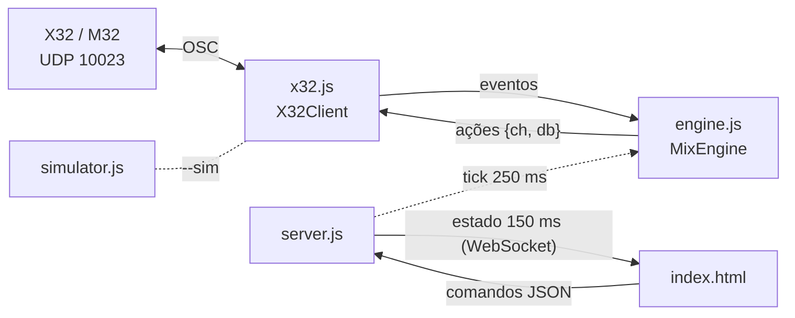

# mixTree

Assistente de mix de fone (monitor) para mesas digitais Behringer **X32 / M32**. O projeto contém uma única aplicação, `mix-assist`: um processo Node.js que se comunica com a mesa via **OSC sobre UDP**, ajusta os envios dos canais para o bus do fone e serve uma interface web acessível pela rede local (Mac, iPhone ou outro navegador).

O objetivo é manter a mix do fone de um músico (por padrão, o tecladista) organizada durante a execução ao vivo:

1. **Detecção de solista** entre os canais de voz.
2. **Vozes como referência**: backings em envio fixo (−10 dB por padrão) e solista acompanhando o teclado, com teto absoluto de envio (−8 dB por padrão).
3. **Teto por instrumento em relação à âncora** (o instrumento do dono do fone; o teclado, por padrão): quando um instrumento ultrapassa o seu limite, o envio dele é reduzido. O motor nunca aumenta instrumentos nem altera a âncora.

O mapa de canais pode ser **detectado pela mesa** (nome e ícone de cada canal) e revisado pela interface; ver [Mapa de canais dinâmico](#mapa-de-canais-dinâmico).

## Sumário

- [Estrutura do repositório](#estrutura-do-repositório)
- [Requisitos](#requisitos)
- [Execução](#execução)
- [Configuração](#configuração)
- [Visão geral da arquitetura](#visão-geral-da-arquitetura)
- [Regras de segurança](#regras-de-segurança)
- [Testes](#testes)
- [Limitações conhecidas](#limitações-conhecidas)
- [Documentação adicional](#documentação-adicional)

## Estrutura do repositório

```
mixTree/
├── README.md                          este documento
├── CHANGELOG.md                       histórico de versões
├── docs/
│   └── ARQUITETURA.md                 arquitetura, diagramas e protocolo WebSocket
├── prompt-claude-code-mix-assist.md   especificação original do projeto
└── mix-assist/
    ├── package.json                   scripts start, sim e test
    ├── config.json                    mesa, bus, mapa de canais e parâmetros do motor
    ├── README.md                      guia de uso (operador)
    ├── src/
    │   ├── automap.js                 classificação de canais e checagem de patch (puro)
    │   ├── configfile.js              edição do config.json preservando a formatação (puro)
    │   ├── osc.js                     codec OSC 1.0, lei de fader, blobs de meters
    │   ├── x32.js                     cliente UDP da mesa e descoberta por broadcast
    │   ├── engine.js                  motor de regras puro (sem I/O, relógio injetado)
    │   ├── simulator.js               mesa simulada para desenvolvimento
    │   └── server.js                  composição: HTTP, WebSocket e laços de execução
    ├── public/
    │   └── index.html                 interface web (sem framework)
    └── test/
        ├── engine.test.js             motor, OSC e lei de fader
        ├── automap.test.js            classificador, sugestão, confirmação e patch
        ├── configfile.test.js         edição do config.json
        └── x32-sim.test.js            integração UDP cliente ↔ simulador
```

## Requisitos

- **Node.js 20 ou superior** (o código usa ESM e `Array.prototype.findLast`).
- Dependência externa única: [`ws`](https://www.npmjs.com/package/ws).
- Para uso com a mesa real: o computador deve estar na mesma rede da X32/M32, com a porta UDP **10023** acessível.

## Execução

Todos os comandos são executados no diretório `mix-assist/`.

```bash
cd mix-assist
```

```bash
npm install
```

### Modo simulado

Sobe uma mesa falsa em `127.0.0.1` (porta escolhida pelo sistema) que gera uma música sintética em seções de 20 s, com alternância de solistas e instrumentos acima do teclado. Não requer hardware.

```bash
npm run sim
```

### Mesa real

Usa `mixer.host`, `mixer.port` e `bus` de `config.json`.

```bash
npm start
```

Ao iniciar, o terminal exibe as URLs de acesso:

```
Mix Assist — X32 192.168.1.104:10023 · Bus 2
  Local:   http://localhost:3000
  Rede:    http://192.168.x.x:3000   (abra no iPhone)
```

A porta HTTP pode ser sobrescrita pela variável de ambiente `PORT`:

```bash
PORT=3001 npm run sim
```

Mesa, simulador e bus também podem ser trocados pela interface, sem reiniciar o processo, tocando no indicador "Bus N" no topo da página. Cada troca coloca o assistente em modo **Desligado** e relê o estado da mesa.

### Modos de operação

| Modo | Comportamento |
|---|---|
| **Desligado** (`off`) | Apenas observa e exibe sugestões. Nada é escrito na mesa. |
| **Assistido** (`assist`) | Exibe sugestões e aplica somente as aprovadas pelo operador. |
| **Automático** (`auto`) | Aplica os alvos em etapas, com confirmação, rampa e descanso entre etapas. |

## Configuração

Arquivo: `mix-assist/config.json`.

```json
{
  "mixer": { "host": "192.168.1.104", "port": 10023 },
  "bus": 2,
  "web": { "port": 3000 },
  "channels": [
    { "ch": 15, "role": "keyboard", "name": "KEYS L" },
    { "ch": 16, "role": "keyboard", "name": "KEYS R" },
    { "ch": 20, "role": "vocal", "name": "VOZ MIC PR" },
    { "ch": 1,  "role": "ref", "name": "BB", "group": "bateria", "ceilingDb": -4 },
    { "ch": 14, "role": "ref", "name": "BAIXO", "group": "baixo" }
  ],
  "engine": {
    "vocalBackingDb": -10,
    "vocalSoloMaxDb": -8,
    "groupCeilingDb": { "bateria": -10, "baixo": -3, "violão": -8, "guitarra": -8, "sopro": -8 }
  }
}
```

| Chave | Descrição |
|---|---|
| `mixer.host`, `mixer.port` | Endereço da mesa. Atualizado automaticamente ao trocar de mesa pela interface. |
| `bus` | Bus do fone (1–16). Atualizado automaticamente ao trocar pela interface (apenas com mesa real). |
| `web.port` | Porta HTTP/WebSocket. `PORT` no ambiente tem precedência. |
| `channels[].ch` | Número do canal (1–32). |
| `channels[].role` | `anchor` (instrumento do dono do fone; um ou dois canais, L/R tratados como par estéreo), `vocal` (candidatos a solista) ou `ref` (demais instrumentos). `keyboard` é aceito como sinônimo de `anchor` com grupo `teclado`. |
| `channels[].group` | Grupo do instrumento; define a cor na interface e o teto via `groupCeilingDb`. |
| `channels[].ceilingDb` | Teto do canal em dB relativo à âncora. Tem precedência sobre o grupo. |
| `channels[].seen` | Gravado pela folha **Canais**: nome e ícone vistos na mesa ao confirmar o mapa. Usado para detectar troca de patch. Canais sem `seen` (config manual) não são verificados. |
| `autoMap.rules` | Opcional. Lista de regras de nome (`{ "match": "<regex>", "role": "vocal" \| "ref" \| "ignore", "group": "..." }`) que **substitui** as regras padrão de `src/automap.js`. |
| `autoMap.icons` | Opcional. Mapa `{ "<id do ícone>": { "role": ..., "group": ... } }` que complementa/sobrescreve a tabela padrão de ícones. |
| `engine` | Sobrescreve qualquer parâmetro de `DEFAULTS` em `src/engine.js`. |

### Mapa de canais dinâmico

Em vez de escrever `channels` à mão, abra **Mesa → Detectar canais da mesa**:

1. O app lê nome, ícone e cor dos 32 canais e se cada um manda para o bus do fone.
2. Cada canal recebe uma sugestão: primeiro pelas **regras de nome** (ex.: `VOZ`, `BV` → voz; `GTR` → guitarra; `VIOLAO` → violão; `BB`, `CX`, `HH` → bateria; `PB`, `CLICK`, `FX` → fora do mapa), depois pelo **ícone** quando o nome não diz nada. Canais que já estavam no mapa com o mesmo nome mantêm o que foi decidido antes.
3. Em **Fone de**, escolha o instrumento do dono do fone (âncora). O nome do bus (ex.: `FONE GUITARRA`) é usado como sugestão.
4. Revise e confirme. O assistente é desligado, o mapa é aplicado sem reiniciar e gravado em `config.json` (com o simulador, só em memória).

Depois disso, se o nome ou o ícone de um canal confirmado mudar na mesa (troca de patch, cena diferente), o assistente é **desligado e bloqueado** e a página mostra o que mudou, com o botão **Revisar**. Ele só volta a poder ser ligado quando o mapa é confirmado de novo ou o patch volta ao que era.

Regras de nome e ícones podem ser adaptados às abreviações da sua equipe em `autoMap` (ver tabela acima). Exemplo:

```json
"autoMap": {
  "rules": [
    { "match": "\\b(LOUVOR|MINISTRO|VOZ)", "role": "vocal" },
    { "match": "\\b(CTB|BAIXO)", "role": "ref", "group": "baixo" },
    { "match": "\\b(PB|CLICK)", "role": "ignore" }
  ],
  "icons": { "52": { "role": "vocal" } }
}
```

### Parâmetros do motor

Valores padrão definidos em `mix-assist/src/engine.js` (`DEFAULTS`). O `config.json` distribuído sobrescreve parte deles.

| Parâmetro | Padrão | Descrição |
|---|---|---|
| `gateDb` | −45 | Limiar abaixo do qual o canal é considerado em silêncio |
| `meterTauSec` | 1,2 | Constante de tempo do envelope lento |
| `fastTauSec` | 0,3 | Constante de tempo do envelope rápido (detecção de fim de frase) |
| `fadeDb` | 6 | Queda do envelope rápido em relação ao lento que caracteriza fim de frase |
| `keyRefTauSec` | 8 | Constante de tempo da referência do teclado |
| `warmupSec` | 4 | Tempo de teclado ativo antes de o motor agir |
| `soloLeadDb` | 3 | Vantagem necessária para uma voz desafiar a solista |
| `soloHoldSec` | 1,5 | Tempo de liderança necessário para trocar de solista |
| `soloReleaseSec` | 4 | Silêncio após o qual a solista é liberada |
| `soloVsKeyDb` | 0 | Posição da solista em relação ao teclado |
| `vocalBackingDb` | −10 | Envio dos backings |
| `vocalSoloMaxDb` | −8 | Envio máximo da solista e de qualquer voz |
| `ceilingDb` | −1 | Teto padrão de instrumento, relativo ao teclado |
| `groupCeilingDb` | `{}` | Teto por grupo, relativo ao teclado |
| `maxBoostDb` | 6 | Aumento máximo acima da mix base |
| `maxCutDb` | 10 | Corte máximo ao alinhar vozes |
| `maxCeilingCutDb` | 30 | Corte máximo para manter um instrumento abaixo do teto |
| `maxRateDbPerSec` | 1 | Velocidade padrão da rampa |
| `deadbandDb` | 0,75 | Diferença mínima para gerar alvo |
| `autoStartDb` | 1,5 | Diferença mínima para iniciar uma etapa no modo automático |
| `dwellSec` | 2,5 | Tempo de confirmação antes de iniciar uma etapa |
| `ceilingDwellSec` | 1 | Tempo de confirmação quando o alvo é um teto |
| `maxMoveDb` | 3 | Tamanho máximo de uma etapa |
| `settleSec` | 6 | Descanso após uma etapa |
| `cutMaxMoveDb` | 6 | Tamanho máximo de uma etapa de corte rápido |
| `cutRateDbPerSec` | 2 | Velocidade do corte rápido |
| `cutSettleSec` | 2 | Descanso após uma etapa de corte rápido |
| `manualHoldSec` | 20 | Duração da trava após ajuste manual |
| `busClipDb` | −3 | Nível do bus que gera alerta de clipagem |

## Visão geral da arquitetura



- O **motor** é puro: não acessa rede nem temporizadores. Todo método recebe o instante atual (`now`), o que permite testes determinísticos.
- A contribuição de cada canal no fone é estimada como **nível de entrada (meter) + envio**; a do teclado usa uma referência lenta do nível de entrada somada ao envio médio dos canais de teclado.
- O detalhamento (modelo de sinal, máquina de estados da solista, cálculo de alvos, execução em etapas, protocolo WebSocket e lei de fader) está em [docs/ARQUITETURA.md](docs/ARQUITETURA.md).

## Regras de segurança

- O único endereço escrito na mesa é `/ch/NN/mix/BB/level`, em que `BB` é o bus configurado. PA, faders de canal, nomes, ícones e outros buses não são alterados (o patch só é lido).
- O motor nunca altera os canais âncora. A âncora só muda por ação explícita do operador na interface (card com o nome do grupo, ex.: **TECLADO**), que move L e R pela mesma quantidade.
- A restrição é aplicada em duas camadas: no motor e no cliente UDP (`setSend` descarta canais fora do mapa e canais âncora).
- A detecção de canais apenas **sugere**; o mapa só vale após confirmação. Canal não classificado fica fora do mapa e não recebe escrita.
- Patch divergente do mapa confirmado ⇒ assistente desligado e bloqueado até revisão.
- Qualquer alteração de envio feita fora do motor (na mesa, no Mixing Station ou na página) trava o canal por `manualHoldSec` e passa a valer como mix base daquele canal.

## Testes

```bash
cd mix-assist && npm test
```

A suíte (`node:test`, 91 casos, sem dependências extras) cobre:

- `test/engine.test.js`: lei de fader, codec OSC e blobs de meters, histerese da solista, alvos de vozes e instrumentos, velocidade e etapas das rampas, imutabilidade da âncora pelo motor, trava após ajuste manual, aprovação no modo assistido, comportamento em silêncio, âncora estéreo, troca de bus e de mesa, precedência de tetos (canal → grupo → padrão), ajuste manual da âncora, âncora de outro instrumento, sinônimo `keyboard` e bloqueio por troca de patch.
- `test/automap.test.js`: regras de nome (com e sem acento, abreviações, fronteira de palavra), ícones, prioridade nome → ícone, regras do config, sugestão de âncora pelo nome do bus, validação do mapa, sugestão preservando decisões anteriores, confirmação (âncora, `seen`, tetos preservados) e checagem de patch.
- `test/configfile.test.js`: gravação de `channels` no `config.json` preservando o resto do arquivo.
- `test/x32-sim.test.js`: integração por UDP local entre `X32Client` e o simulador (leitura do patch, aviso de renomeação por `/xremote`, escrita de nome/ícone por OSC e troca de mapa com a trava da âncora).

### Integração contínua

O workflow [`.github/workflows/ci.yml`](.github/workflows/ci.yml) roda `npm ci` e `npm test` em `mix-assist/` no GitHub Actions:

- em todo pull request (aberto, atualizado, reaberto ou marcado como pronto para revisão);
- em push na `main`;
- manualmente, pela aba **Actions** (`workflow_dispatch`).

A suíte roda em matriz nas versões 20, 22 e 24 do Node.js (a 20 é a mínima de `engines`). Um novo push no mesmo PR cancela a execução anterior. Para impedir merge com testes quebrando, marque os checks `Testes (Node …)` como obrigatórios em **Settings → Branches → Branch protection rules** da `main`.

## Limitações conhecidas

- **Os meters fornecem nível, não espectro.** O motor equilibra volume; não trata mascaramento de frequência.
- **O envio para o bus do fone deve estar em pre-fader.** Em post-fader, o fader do canal no PA interfere na estimativa sem que o motor tenha essa informação.
- **Índices de meters assumidos:** os 32 primeiros valores de `/meters/1` correspondem aos canais 1–32, e o valor `bus − 1` de `/meters/2` corresponde ao bus do fone. Recomenda-se conferir no primeiro uso com a mesa real.
- Microfones com vazamento acima de `gateDb` são considerados ativos; ajuste o parâmetro conforme o ambiente.
- Um ajuste manual que coincida (diferença menor que 0,4 dB) com um valor enviado pelo motor nos últimos 3 s não é reconhecido como manual.
- **A detecção de canais depende de o técnico nomear (ou pôr ícone) nos canais da mesa.** Sem nomes, a folha Canais mostra os canais como "não reconhecido" e o mapa é montado à mão nela.
- **Numeração dos ícones a conferir:** a tabela `X32_ICONS` segue a documentação OSC não oficial da X32. Confira na sua mesa/firmware e ajuste `autoMap.icons` se necessário. Por isso o nome tem prioridade sobre o ícone.
- Abreviações locais (ex.: "MIN" para ministro) precisam de regra própria em `autoMap.rules`.

## Documentação adicional

- [docs/ARQUITETURA.md](docs/ARQUITETURA.md): arquitetura detalhada e diagramas.
- [mix-assist/README.md](mix-assist/README.md): guia de uso voltado ao operador.
- [CHANGELOG.md](CHANGELOG.md): histórico de versões.
- [prompt-claude-code-mix-assist.md](prompt-claude-code-mix-assist.md): especificação original (as decisões posteriores, registradas no CHANGELOG, prevalecem sobre ela).
