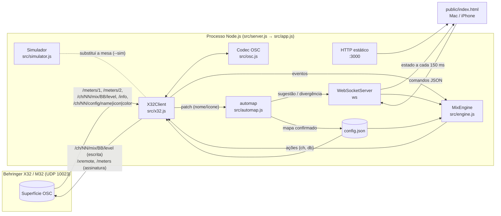
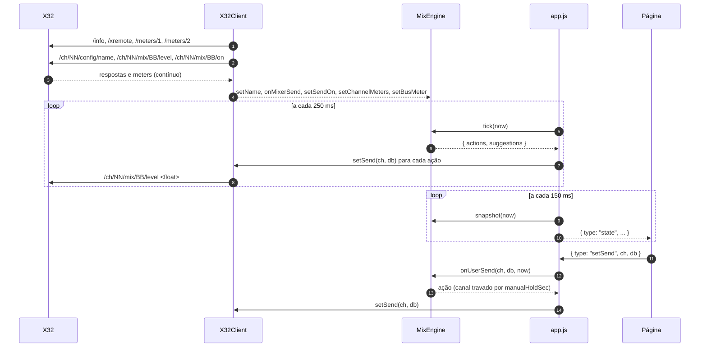
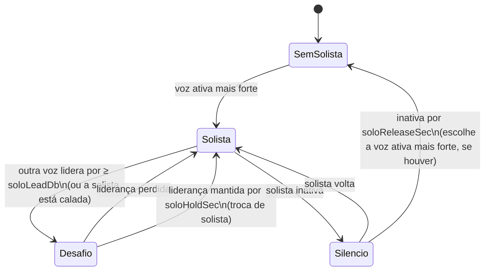
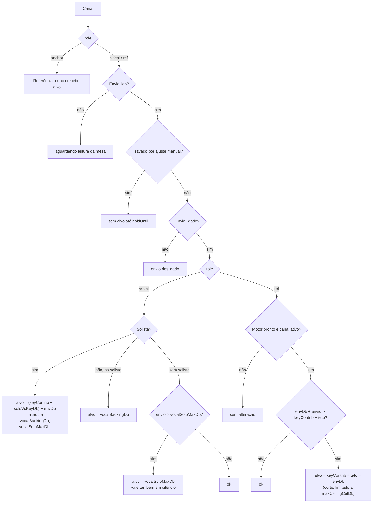
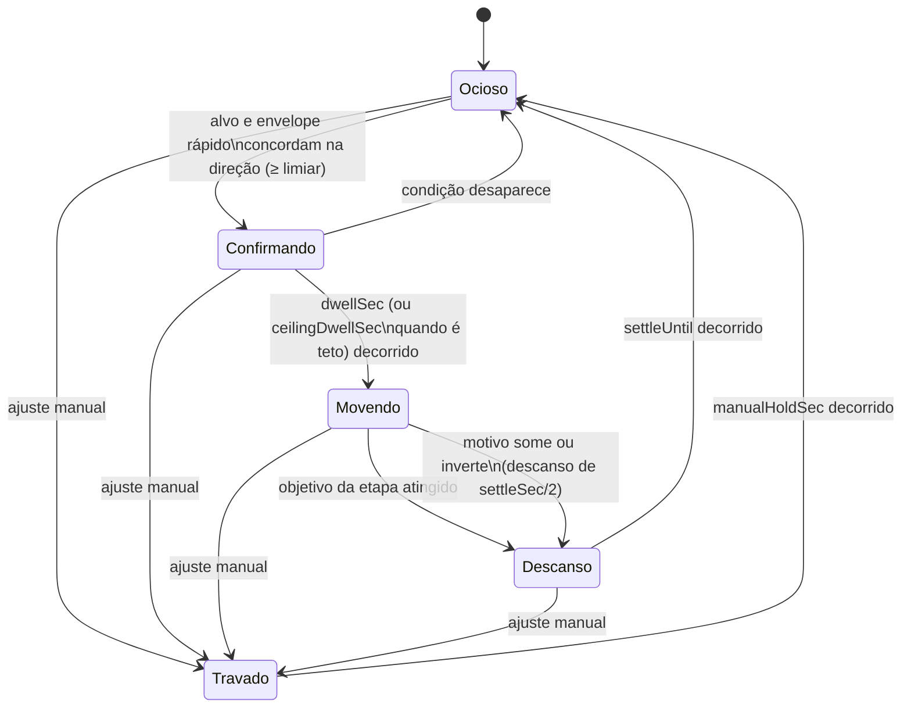
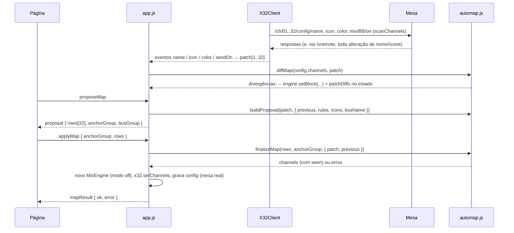

# Arquitetura

Este documento descreve a estrutura interna do `mix-assist`. A fonte da verdade é o código em `mix-assist/src/`; as referências de arquivo e linha indicam onde cada comportamento está implementado.

## 1. Componentes



| Módulo | Responsabilidade | Efeitos colaterais |
|---|---|---|
| `src/osc.js` | Codificação/decodificação OSC 1.0 (`i`, `f`, `s`, `b`), lei de fader da X32, blobs de meters | Nenhum |
| `src/x32.js` | Cliente UDP; assinatura de `/xremote` e meters (renovada a cada 8 s); leitura de nomes, envios e estado `on`; descoberta de mesas por broadcast `/info` | Rede (UDP) |
| `src/engine.js` | Motor de regras puro: envelopes de nível, detecção de solista, cálculo de alvos, rampas, travas e histórico. O relógio é injetado via `now` | Nenhum |
| `src/automap.js` | Classificação de canais por nome e ícone, sugestão de mapa, confirmação (âncora, `seen`) e checagem de troca de patch | Nenhum |
| `src/configfile.js` | Substituição de uma chave de primeiro nível do `config.json` sensível a strings, preservando o resto do arquivo | Nenhum |
| `src/simulator.js` | Mesa falsa que responde OSC e gera meters de uma música sintética em seções de 20 s | Rede (UDP local) |
| `src/app.js` | Composição (`createApp`): liga cliente, motor, HTTP e WebSocket; troca de mesa e de bus em tempo de execução; persistência pontual em `config.json`. Sem efeitos ao importar: config, caminhos, logger, scanner e intervalos são injetados | Rede, sistema de arquivos |
| `src/server.js` | Ponto de entrada: lê o `config.json` (ou `MIX_ASSIST_CONFIG`), chama `createApp`, mostra os endereços e encerra limpo com SIGINT/SIGTERM | Processo |
| `public/index.html` | Interface sem framework (HTML, CSS e JS inline) | — |

## 2. Laços de execução

O servidor mantém quatro temporizadores independentes:

| Intervalo | Origem | Função |
|---|---|---|
| 250 ms | `app.js` | `engine.tick(now)`; as ações retornadas são enviadas à mesa |
| 150 ms | `app.js` | Difusão do estado (`engine.snapshot`) para todos os clientes WebSocket |
| 3 s | `app.js` | Releitura completa enquanto algum envio ainda não foi lido (perda de pacote UDP) |
| 8 s | `x32.js` | Renovação de `/xremote`, `/meters/1` e `/meters/2` |



## 3. Modelo de sinal

Para cada canal, `setChannelMeters` (`src/engine.js:158`) mantém dois envelopes de potência a partir dos 32 primeiros valores de `/meters/1`:

- **lento** (`meterTauSec`, 1,2 s) → `envDb`;
- **rápido** (`fastTauSec`, 0,3 s) → `fastDb`.

Um canal é considerado **ativo** quando os dois envelopes estão acima de `gateDb`. Ele está **caindo** (fim de frase) quando `fastDb < envDb − fadeDb`; nessa condição nenhum envio é aumentado.

A **referência da âncora** (`keyRefPow`; o teclado, por padrão) é a média de potência dos canais `anchor` (mono ou estéreo), filtrada com `keyRefTauSec` (8 s) e atualizada apenas enquanto o teclado toca. O motor só age depois de `warmupSec` segundos de teclado ativo.

A contribuição de um canal no fone é estimada por:

```
contribuição(canal)  = envDb + envio
contribuição(teclado) = keyRefDb + média(envios do teclado)
```

## 4. Detecção de solista

Implementada em `_updateSoloist` (`src/engine.js:310`).



## 5. Cálculo de alvos

Implementado em `_computeTargets` (`src/engine.js:357`) e `_vocalTarget` (`src/engine.js:427`).



O **teto** de um instrumento (`ref`) é resolvido na construção do motor (`src/engine.js:61`), em ordem de precedência:

1. `ceilingDb` do canal em `config.channels`;
2. `engine.groupCeilingDb[grupo]`;
3. `engine.ceilingDb` (padrão −1 dB).

Todos os alvos são arredondados para 0,5 dB. Diferenças menores que `deadbandDb` não geram ação.

## 6. Modos e execução das ações

| Modo | Origem do objetivo | Escrita na mesa |
|---|---|---|
| `off` | — | Nenhuma; apenas sugestões |
| `assist` | `approved`, definido por `approve(ch)` ou `approveAll()` | Em rampa, até o valor aprovado |
| `auto` | `_autoGoal` (`src/engine.js:536`) | Em etapas, conforme o diagrama abaixo |



Parâmetros de cada etapa:

| Situação | Tamanho máximo | Velocidade | Descanso |
|---|---|---|---|
| Padrão (vozes, subidas) | `maxMoveDb` (3 dB) | `maxRateDbPerSec` | `settleSec` (6 s) |
| Corte rápido (instrumento acima do teto, descendo) | `cutMaxMoveDb` (6 dB) | `cutRateDbPerSec` (2 dB/s) | `cutSettleSec` (2 s) |

A velocidade é multiplicada por um fator de desaceleração `clamp(|diferença| / 1,5, 0,3, 1)`, o que evita degraus no início e no fim do movimento.

O limiar mínimo para iniciar uma etapa é:

- 0,1 dB para voz acima do teto absoluto (`hardCap`);
- `deadbandDb` para alvo fixo (backing) ou teto de instrumento;
- `autoStartDb` nos demais casos.

## 7. Detecção de ajuste manual

`onMixerSend` (`src/engine.js:180`) recebe toda alteração de envio ecoada pela mesa via `/xremote`. Uma mudança é tratada como manual quando:

- difere do último valor conhecido em pelo menos 0,4 dB; e
- não corresponde (tolerância de 0,4 dB, após quantização do fader) a nenhum comando emitido pelo próprio motor nos últimos 3 s.

Nesse caso o canal é travado por `manualHoldSec`, o novo valor passa a ser a mix base daquele canal e qualquer etapa em andamento é cancelada. Ajustes feitos pela página (`onUserSend`) seguem a mesma regra.

## 8. Travas de segurança na escrita

A escrita é restrita em duas camadas independentes:

1. **Motor** (`src/engine.js`): canais `anchor` (ou `keyboard`, normalizado para `anchor`) nunca recebem alvo, não são aprovados e não entram em `restoreBase`. A âncora só muda por `adjustKeyboard`, chamado exclusivamente pela mensagem `anchor` (ou `keyboard`) da página. Com `setBlock(motivo)` ativo, o modo fica em `off` e `setMode` recusa `assist`/`auto`.
2. **Cliente** (`src/x32.js`): `setSend` descarta qualquer canal fora do mapa atual e qualquer canal âncora. A âncora tem um método separado, `setKeyboardSend`. `setChannels` troca o mapa em execução e recalcula as duas listas.

O único endereço escrito em ambos os casos é `/ch/NN/mix/BB/level`, onde `BB` é o bus configurado.

## 9. Troca de mesa e de bus em execução

| Operação | Função | Efeito no motor | Persistência |
|---|---|---|---|
| Trocar IP ou ir para o simulador | `connectTo` (`src/app.js:161`) | `resetMixer()`: zera envios, envelopes, solista e referência do teclado; modo volta a `off` | IP e porta gravados em `config.json` (apenas mesa real) |
| Trocar bus do fone | `setBus` (`src/app.js:204`) | `resetBus()`: zera envios e travas; modo volta a `off`; a referência do teclado é mantida | `bus` gravado em `config.json` (apenas mesa real) |
| Procurar mesas | `scanMixers` (`src/x32.js:144`) | — | — |

A gravação em `config.json` substitui apenas o trecho alterado (por expressão regular para `mixer` e `bus`; por `replaceTopLevel` de `src/configfile.js` para `channels`), preservando a formatação do restante do arquivo.

## 9.1 Mapa de canais dinâmico



Classificação (`classifyChannel`): o nome é normalizado (sem acentos, maiúsculas) e testado contra as regras em ordem — a primeira que casa vence; `role: "ignore"` deixa o canal de fora. Só se nenhuma regra casar é que o ícone é consultado. O nome vem antes porque é texto explícito do operador e porque a numeração dos ícones precisa ser conferida por firmware.

Sugestão (`buildProposal`): para cada canal 1–32, se ele já está no mapa e o nome não mudou (comparado com `seen.name` ou `name`), mantém papel e grupo anteriores (`source: "config"`); senão, classifica. A âncora sugerida é o grupo da âncora atual ou, sem mapa anterior, o grupo inferido do nome do bus do fone.

Confirmação (`finalizeMap`): canais `ref` do grupo escolhido viram `anchor`; vozes nunca viram âncora. Cada canal guarda `seen: { name, icon }`. `ceilingDb` por canal é preservado se o grupo não mudou. Sem nenhum canal do grupo âncora, o mapa é recusado.

Troca de patch (`diffMap`): só canais com `seen` são verificados, e só campos já lidos da mesa contam, para que um pacote ainda não recebido não gere alarme falso. Ao trocar de mesa, o patch lido é zerado e o bloqueio, removido.

## 10. Protocolo WebSocket

### Servidor → página

Uma mensagem `state` a cada 150 ms:

| Campo | Descrição |
|---|---|
| `connected`, `simulated`, `switching`, `connError` | Estado da conexão com a mesa |
| `mixer`, `realMixer` | Destino atual (com `name`, `model`, `fw` de `/info`) e mesa real configurada |
| `scan` | `{ running, found[], at }` da descoberta de mesas |
| `bus`, `busNames`, `busFaderDb`, `busDb` | Bus do fone, nomes dos 16 buses, fader e meter do bus |
| `mode`, `block`, `anchorName`, `ready`, `soloist`, `keyContrib`, `keyRefDb` | Estado do motor (`block`: motivo do bloqueio ou `null`; `anchorName`: grupo da âncora) |
| `patchDiffs[]` | `{ ch, reasons, expected, actual }` para canais cujo nome/ícone na mesa não bate com o mapa confirmado |
| `channels[]` | Por canal: `ch`, `name`, `role`, `group`, `ceilingDb`, `sendDb`, `baseDb`, `on`, `envDb`, `contribDb`, `targetContribDb`, `active`, `solo`, `target`, `approved`, `held`, `holdLeftSec`, `reason` |
| `suggestions[]` | `{ ch, name, from, to, reason }`; inclui alerta de bus próximo de clipar |
| `history[]` | Últimas 60 alterações, mais recentes primeiro |

### Página → servidor

| `type` | Campos | Efeito |
|---|---|---|
| `mode` | `mode`: `off` \| `assist` \| `auto` | Altera o modo |
| `approve` | `ch` | Aprova a sugestão do canal (modo assistido) |
| `approveAll` | — | Aprova todas as sugestões |
| `saveBase` | — | Grava os envios atuais como mix base |
| `restoreBase` | — | Restaura a mix base e trava os canais alterados |
| `setSend` | `ch`, `db` (−90 a +10) | Ajuste manual de um envio (exceto âncora) |
| `anchor` (ou `keyboard`) | `delta` (−6 a +6 dB) | Ajuste manual da âncora; L e R juntos |
| `scanChannels` | — | Relê nome, ícone, cor e envio ligado dos 32 canais |
| `proposeMap` | — | Responde só a quem pediu com `{ type: "proposal", rows[32], anchorGroup, busName, busGroup }` |
| `applyMap` | `anchorGroup`, `rows[] { ch, role, group }` | Aplica o mapa confirmado; responde `{ type: "mapResult", ok, error }` |
| `refresh` | — | Relê envios, nomes e nomes de bus |
| `busNames` | — | Relê os nomes dos buses |
| `connect` | `source: "sim"` ou `host`, `port` | Troca a mesa em execução |
| `scan` | — | Procura mesas na rede por broadcast |
| `setBus` | `bus` (1–16) | Troca o bus do fone |

## 11. Lei de fader

Conversão implementada em `src/osc.js:97`. O valor float é quantizado em 1024 passos.

| Faixa (dB) | float → dB |
|---|---|
| ≥ −10 | `f · 40 − 30` |
| −30 a −10 | `f · 80 − 50` |
| −60 a −30 | `f · 160 − 70` |
| −90 a −60 | `f · 480 − 90` |
| `f ≤ 0` | −90 (−∞) |
